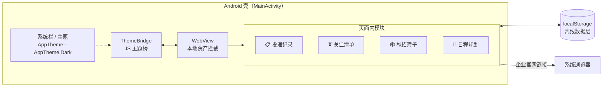

# 📯 OfferBeacon · 秋招投递记录工作台

> 一个面向秋招求职者的**纯本地、离线优先**的 Android 应用：
> 管理投递记录、关注清单、秋招筛子与面试日程，内置「各大企业 / 央国企」双赛道，
> 支持黑暗模式。数据 100% 存在本机，不上传任何服务器。


---

## ✨ 功能模块

| 模块 | 功能 |
|------|------|
| 📋 **投递记录** | 记录每次投递（企业 / 岗位 / Base / 状态 / 日期 / 备注）；9 档彩色状态标签（已投简历 → 等offer / 挂）；按关键词搜索、按状态筛选、5 种排序；「详细 / 紧凑」双视图 |
| ⚡ **快速新增** | 顶部常驻一栏，企业名 + 状态两步完成一次投递登记 |
| ⏳ **关注清单** | 收藏还没开放投递的企业，标记「预计开放时间」，秋招未开启时提前占位 |
| 🕸 **秋招筛子** | 批量粘贴企业名单（支持顿号 / 逗号 / 换行分隔、可带官网链接）放入「篓子」，逐个官网核实；已投过的企业自动打绿色 ✓ 标记 |
| 📅 **日程规划** | 线性时间线展示全部笔试 / AI 面试 / 各轮面试（按日期分组、从早到晚）；月份日历点选日期联动筛选；月度分布统计 + 近 7 日投递节奏条形图 |
| 🏢🏛 **双赛道** | 「各大企业」与「央国企」数据完全独立，侧边栏一键切换；日程规划页标题旁下拉框自由切换并联动 |
| 🌙 **黑暗模式** | 页内一键切换浅色 / 深色，跟随系统暗色自动适配；下拉弹层、日期时间弹框等原生控件同步变暗 |
| 🔗 **外链直达** | 点击企业官网链接跳转系统浏览器打开，WebView 内不迷路 |

---

## 🏗 应用架构

APK 是一个轻量 **WebView 壳**：业务页面（单文件 `index.html`，无框架、无构建依赖）作为本地资产打包，
通过虚拟域名 `https://offerbeacon.local/` 加载，保证 `localStorage` 拥有稳定同源 origin，升级安装不丢数据。



### 原生弹层主题同步机制

黑暗模式下，网页 CSS 无法控制 Android 原生弹窗（`<select>` 下拉弹层、日期时间选择器）。
本项目通过 **JS 桥 → 运行时 Activity 主题切换** 解决：

```mermaid
sequenceDiagram
    participant 页面 as index.html（paintTheme）
    participant 壳 as MainActivity（ThemeBridge）
    participant 系统 as 原生弹层/弹框

    页面->>壳： OfferBeaconTheme.setTheme('dark')
    壳->>壳： setTheme(AppTheme_Dark) + SharedPreferences 持久化
    壳->>系统： 之后弹出的下拉弹层 / 日期弹框 → 暗色渲染
    壳-->>页面： 系统栏颜色、WebView 背景色同步
```

- 运行时 `setTheme()` 只影响**之后弹出**的原生对话框，不触碰已渲染的页面 —— 页面配色仍由页内 `data-theme` 管理，互不干扰
- 主题状态持久化到 `SharedPreferences`，冷启动 / 旋转屏幕后弹层主题不丢
- 未开启 forceDark / 算法调暗，避免对自带暗色样式的页面二次"抹暗"

---

## 🛠 技术栈

| 层 | 技术 |
|----|------|
| 壳工程 | 原生 Android（单 Activity，Java 8，无 Gradle / 无第三方依赖） |
| 页面 | 单文件 `index.html`：原生 HTML/CSS/JS（约 3900 行），CSS 变量主题系统 + `prefers-color-scheme` |
| 数据 | `localStorage` 离线存储；页面保留资料库在线双向同步能力，检测不到宿主 SDK 时自动降级为纯离线模式 |
| 构建 | `aapt2`（资源编译/链接）→ `javac` → `d8`（dex）→ `zipalign` → `apksigner`，一条 `build.sh` 搞定 |
| 签名 | 项目内 `offerbeacon.keystore`（构建脚本缺失时自动生成） |

**设计取舍**：不引入 Gradle / AndroidX / WebView 库，构建链只依赖 Android SDK 命令行工具，
APK 体积仅 **~80 KB**，冷启动即开即用。

---

## 🚀 快速开始

### 安装使用（普通用户）

1. 下载仓库中的 [`OfferBeacon.apk`](./OfferBeacon.apk)
2. 传输到 Android 手机（Android 7.0+），点击安装（允许"未知来源"）
3. 打开 App 即用，所有数据存于本机应用私有目录，卸载或换机需自行迁移数据

### 从源码构建（开发者）

**环境要求**

| 依赖 | 版本 |
|------|------|
| JDK | 8+（构建脚本用 `javac`，密钥生成用 keytool） |
| Android SDK Build-Tools | 34.0.0（资源/签名），35.0.0（d8，规避 34 的内部类崩溃 bug） |
| Android Platform | android-34（`android.jar`） |
| Python | 3.x（构建脚本内嵌 zip 打包步骤） |

**目录约定**：SDK 放在 `./sdk/`（可用 sdkmanager 重建，已 gitignore），结构如下：

```
sdk/
├── build-tools/34.0.0/      # aapt2、zipalign、apksigner
├── build-tools/35.0.0/      # d8
└── platforms/android-34/    # android.jar
```

**一键构建**

```bash
bash build.sh
# [1/7] aapt2 compile resources
# ...
# === verify ===
# BUILD_OK   → 产出 ./OfferBeacon.apk
```

**运行验收测试**（静态检查 + APK 级验证，共 27 项）

```bash
bash build.sh                 # 先构建（T7 需要新 APK）
bash tests/verify_darkmode.sh # ALL_TESTS_PASSED
```

---

## 📁 项目结构

```
OfferBeaconBuild/
├── app/
│   ├── AndroidManifest.xml        # minSdk 24 · targetSdk 34
│   ├── assets/index.html          # 全部业务页面（单文件 SPA）
│   ├── java/com/offerbeacon/app/
│   │   └── MainActivity.java      # WebView 壳：资产拦截 / 外链分发 / 主题桥
│   └── res/                       # 图标 · strings · styles（浅色 + 暗色主题）
├── sdk/                           # Android SDK（gitignore，本地重建）
├── tests/
│   └── verify_darkmode.sh         # 验收测试（27 项）
├── build.sh                       # 一键构建脚本（7 步流水线）
├── gen_icon.py                    # 启动图标生成脚本
└── OfferBeacon.apk                # 构建产物（已签名）
```

---

## 📝 版本历史

| 版本 | 说明 |
|------|------|
| v1.4.2 | 暗黑模式原生弹层适配：下拉弹层 / 日期弹框经 JS 主题桥同步变暗；新增 27 项验收测试 |
| v1.4.1 | 下拉框 / 日期弹窗恢复第一版原生控件，暗色模式经 color-scheme 适配 |
| v1.4.0 | 首个完整版本：投递记录 / 关注清单 / 秋招筛子 / 日程规划 / 双赛道 |

---

## 🔒 隐私

- 所有业务数据仅存于本机 `localStorage` 与应用私有目录，**无任何服务器、无埋点、无遥测**
- 仅申请 `INTERNET` / `ACCESS_NETWORK_STATE` 权限，用于点击企业官网链接时跳转系统浏览器
- WebView 禁用文件访问 / 内容访问 / 明文流量（`usesCleartextTraffic=false`）
